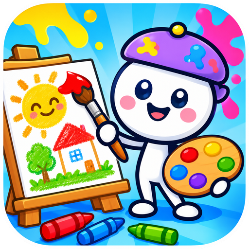

# دنیای رنگ‌ها — Color World Kids

A fully-offline coloring game for kids (2000 drawings across 20 categories), built with
Next.js 16 + TypeScript + Tailwind + shadcn/ui, shipped as **two localized Android APKs**
via Capacitor.

<p>
  
  
</p>

## Downloads / فایل‌های نصب

| File | Language | App name on phone | applicationId |
|---|---|---|---|
| [`download/color-world-fa.apk`](download/color-world-fa.apk) | فارسی | دنیای رنگ‌ها | `com.candyteam.colorworld` |
| [`download/color-world-en.apk`](download/color-world-en.apk) | English | Color World Kids | `com.candyteam.colorworld.en` |

- Fully offline: all 20 categories / 2000 drawings, sounds and artwork storage live inside the APK.
- The Persian build opens in Persian; the English build opens in English (language can always be changed in Settings).
- The two builds have different `applicationId`s, so both can be installed side-by-side.
- At app start the **Candy Team Game Studio logo** intro plays on a **black background**, then the game splash follows.

## Build / ساخت

```bash
npm install            # or bun install
npm run build:apk:fa   # → download/color-world-fa.apk
npm run build:apk:en   # → download/color-world-en.apk
```

Requires JDK 21+ and the Android SDK (`ANDROID_HOME` or `android/local.properties`).
See [HOW-TO-BUILD-APK.md](HOW-TO-BUILD-APK.md) for the full guide.

### App icon / splash sources

- Launcher icon artwork: `upload/gyf-Photoroom.png` → regenerated everywhere via
  `node scripts/make-icons.js` + `bunx capacitor-assets generate --android`.
- Studio intro logo: `upload/candy-studio.webp` → `public/candy-team-logo.webp`.

## Web / hosted version

The normal web build is untouched:

```bash
npm run build && npm start   # Next.js standalone server + /api/artworks (SQLite)
```

Screens auto-detect whether the API exists (hosted) or not (APK) and store artworks
accordingly (IndexedDB on device).

## Project layout

- `src/components/color-world/` — all game screens (intro, splash, home, coloring, gallery, rewards, settings)
- `src/app/` — Next.js App Router entry + API routes (hosted mode)
- `scripts/` — APK build pipeline, icon/voice generators
- `android/` — Capacitor Android wrapper (Gradle 8.14, AGP 8.13, SDK 36)
- `public/voice/` — TTS voice lines used by the game

---

Candy Team Game Studio © 2025
